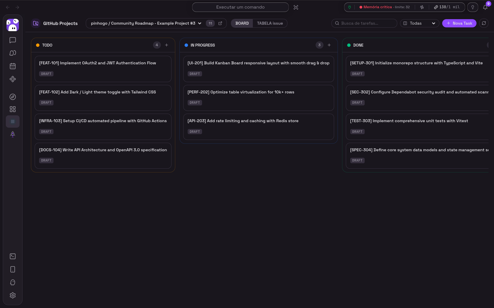
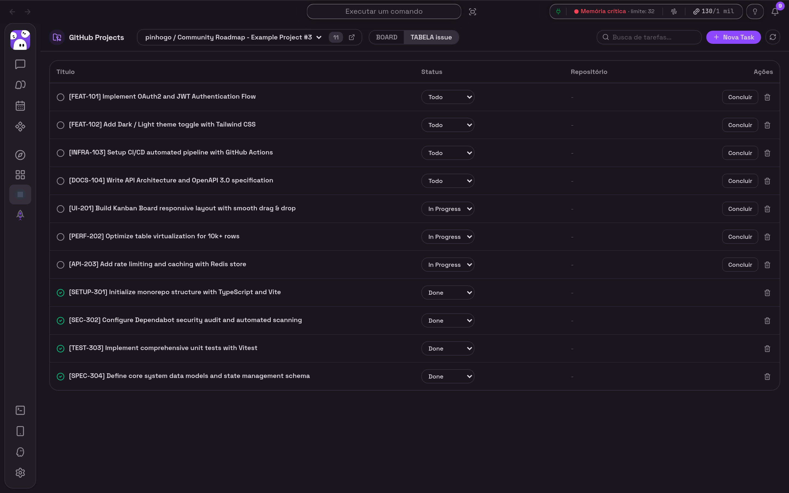
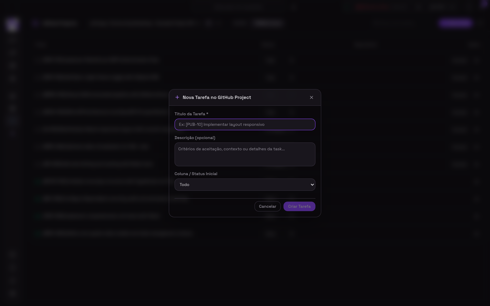

# GitHub Projects for Kiro Crew

[](LICENSE)
[](https://github.com/kirodotdev/KiroCrew)

Native **GitHub Projects v2** Kanban board and issue table integrated into **Kiro Crew**, powered by your authenticated GitHub CLI (`gh`) session.

> 🇧🇷 *Versão em Português abaixo na seção [Em Português](#-em-português).*

---

## 📸 Screenshots

### Kanban Board View


### Issue Table View


### Quick Task Creation Modal


---

## ✨ Features

- **Dynamic Kanban Board & Table View:** Switch seamlessly between multi-column Kanban boards (`BOARD`) and sortable tabular lists (`TABELA issue`).
- **Auto-Detected Owner & Organization Support:** Automatically detects the logged-in `gh` user and lets you switch owners, organizations, or project numbers on the fly.
- **Instant Column Moves, Creation & Deletion:** Move cards to any single-select status column, create new draft issues directly inside a target column, or delete items safely.
- **Compact Column Pager & Search:** Slice visible columns (`1`, `2`, `3`, `4`, or `All`) for narrow sidebar panes and filter tasks in real time by title, issue `#number`, repository, or status.
- **Clean Unicode Rendering:** Automatically decodes escaped Unicode sequences in GitHub item titles cleanly.
- **Bundled Agent & Skill:** Includes the `project-manager` agent and `github-projects` workflow skill.

---

## ⚙️ Prerequisites & Security Notice

1. **GitHub CLI (`gh`) authenticated with `project` scope:**
   ```bash
   gh auth status
   # If not logged in or missing the project scope:
   gh auth login --scopes project
   # Or add the scope to an existing session:
   gh auth refresh -s project
   ```
2. **Python 3** available in `PATH` (uses Python's standard library only — zero extra pip dependencies).
3. **Third-party app execution permission (Important):**
   This app includes an **executable Python backend** (`backend/server.py`) that talks to your local `gh` CLI and verifies Kiro Crew gateway proxy HMAC signatures (`X-KiroCrew-Proxy` / `X-KiroCrew-Proxy-V2`).
   For third-party installs (outside the official allowlist), Kiro Crew blocks executable apps with `app_execution_denied` unless you explicitly allow third-party app execution in `~/.kiro/crew/config.json`:
   ```json
   {
     "agent": {
       "apps_allow_third_party": true
     }
   }
   ```
   After enabling, you can also review/trust the app when prompted during installation.

---

## 🚀 Installation

### Option 1: Install via CLI from GitHub

```bash
kirocrew app install https://github.com/pinhogo/kirocrew-github-projects.git
kirocrew app enable github-projects
```

### Option 2: Install via the Kiro Crew App Store

1. Open the Kiro Crew Dashboard (`http://localhost:5476`).
2. Go to **Discover / Apps**.
3. Find **GitHub Projects** and click **Install**.

### Option 3: Install from a Local Clone

```bash
git clone https://github.com/pinhogo/kirocrew-github-projects.git
cd kirocrew-github-projects
kirocrew app install .
kirocrew app enable github-projects
```

---

## 🛠️ Local Development

To modify the frontend or backend locally:

```bash
# Install frontend build dependencies and compile ui/dist/index.mjs
cd ui
npm install
npx tsc --noEmit
npm run build
cd ..

# Install & watch in development mode
kirocrew app install .
kirocrew app enable github-projects
```

---

## 🇧🇷 Em Português

Plugin completo de **GitHub Projects v2** para o **Kiro Crew**, oferecendo quadro **Kanban dinâmico**, visualização em **Tabela**, movimentação livre entre colunas, criação rápida de tasks, decodificação automática de caracteres Unicode e integração com o agente `project-manager` e a skill `github-projects`.

### Pré-requisitos (PT-BR)
- `gh` autenticado com escopo `project` (`gh auth login --scopes project` ou `gh auth refresh -s project`).
- Python 3 instalado (`server.py` usa apenas biblioteca padrão do Python).
- Como o app possui um backend executável (`backend/server.py`), habilite `"agent": { "apps_allow_third_party": true }` em `~/.kiro/crew/config.json` caso instale diretamente via GitHub URL para evitar o bloqueio `app_execution_denied`.

---

## 📄 License

Distributed under the [MIT License](LICENSE).
